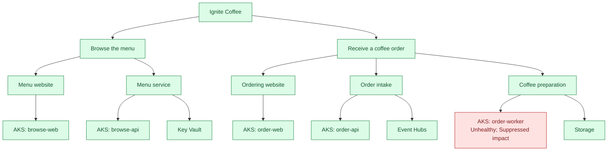

# Ignite Coffee demo plan

## Stage story

The website and API work, but accepted orders cannot be prepared. Show exactly one red entity: **AKS: ignitecoffee-aks (order-worker)**.

The worker's **Suppressed** impact is intentional. Its processing fault does not propagate to Coffee preparation, the order journey or the root. This is a demonstration of impact control, **not** an end-to-end availability claim. Actual customer success still requires a prepared order.

## Structure

These are **expected demo colors**, not a live health snapshot. The five AKS leaves refer to the same cluster and share its CPU signal. Only the worker leaf also reads workload-scoped processing-failure logs.

## What is measured

| Part | Evidence |
|---|---|
| Frontend/API components | Flow-scoped operation failures and fresh process/dependency reports |
| Coffee preparation component | Worker process and Blob container-property checks |
| Worker AKS leaf | `worker-pod` processing failures/freshness, plus cluster CPU |
| Event Hubs | Actual API publish outcomes and freshness of publish attempts |
| Key Vault | Availability, saturation, latency and automatic Resource Health |
| Storage | Availability, latency and automatic Resource Health |

Thresholds and sources are defined once in [`infra\signals.json`](../../infra/signals.json). The [model specification](modelspec.md) explains rollup, query windows and permissions.

## Rehearsal

1. Follow the [deployment runbook](../../README.md#deploy), deploying Workload before Model. Wait for fresh source telemetry and successful preflight.
2. Open the website through port-forwarding. Browse the menu, place an order and show that it remains pending.
3. Show the red worker AKS leaf, its failure logs and Suppressed impact. All other entities should be Healthy if their own evidence is healthy.
4. Run `.\scripts\Set-Fault.ps1 -State Healthy`. Show the prepared order and, after ingestion/evaluation, an all-green graph.
5. Reset with `.\scripts\Set-Fault.ps1 -State Broken`.

The single processing fault does not trigger a journey alert because it is suppressed. A real dependency outage, stopped process or stale telemetry can still change other entities' states; do not hide those failures to force the stage colors.
